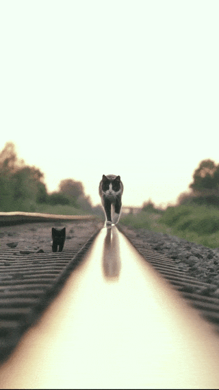

<div align="center">



# Cat Walk

**A small collection of [Hermes Agent](https://hermes-agent.nousresearch.com/docs/) plugins.**

[](https://hermes-agent.nousresearch.com/docs/)
[](LICENSE)

<sub>[Русский](README.md) · **English**</sub>

</div>

---

## Plugins

| Plugin | What it solves | Status |
|---|---|---|
| [**provider-proxy**](https://github.com/xenon007/hermes-plugin-provider-proxy) | Per-target HTTP proxy routing for LLM egress. Send `api.openai.com`, `api.deepseek.com` through a proxy, or keep `api.awesome-corporation.corp` direct — in the same process. Built for closed networks where only a proxy reaches the internet. | v1.0.0 · [tests 75/75](https://github.com/xenon007/hermes-plugin-provider-proxy#testing) |
| [**hermes-motd-plugin**](https://github.com/xenon007/hermes-motd-plugin) | A "don't forget" panel for Hermes Desktop. Loose ends that drown between chats — "send a sticker", "send the node fields" — in one file: the agent appends to it with the `motd_add` tool, and a sidebar page shows the list with one-click command copy. | v1.0.0 · [tests 17/17](https://github.com/xenon007/hermes-motd-plugin#testing) |

More to come. The bar for inclusion: a real problem, tests that prove it, and an
honest limitations section.

## Why "Cat Walk"

Because of the cat at the top of this page. It was the first thing that came to
mind when the first plugin needed a home, and it stuck. The cat does not route
traffic. The cat is just walking.

## Install a plugin

Every plugin here installs the same way — no catalog entry required:

```bash
hermes plugins install xenon007/hermes-plugin-provider-proxy
hermes plugins enable provider-proxy
```

Restart Hermes afterwards. Each plugin's README documents its own configuration
and, importantly, its own limitations — read that section before deploying into a
network you care about.

## Repository layout

```
cat-walk/
├── assets/          shared media used by plugin READMEs
├── README.md        Russian (default)
├── README.en.md     this file
└── LICENSE
```

Media lives here rather than inside individual plugin repositories on purpose:
`hermes plugins install` runs a `git clone`, so shipping a 2 MB GIF with every
install would be rude. Plugin READMEs reference these files by absolute raw URL:

```markdown

```

Absolute rather than relative, because a relative path resolves against the
plugin repository — not this one — and would 404. Keeping the URL pointing here
also means forks of a plugin still render their README correctly.

## License

MIT — see [LICENSE](LICENSE).
